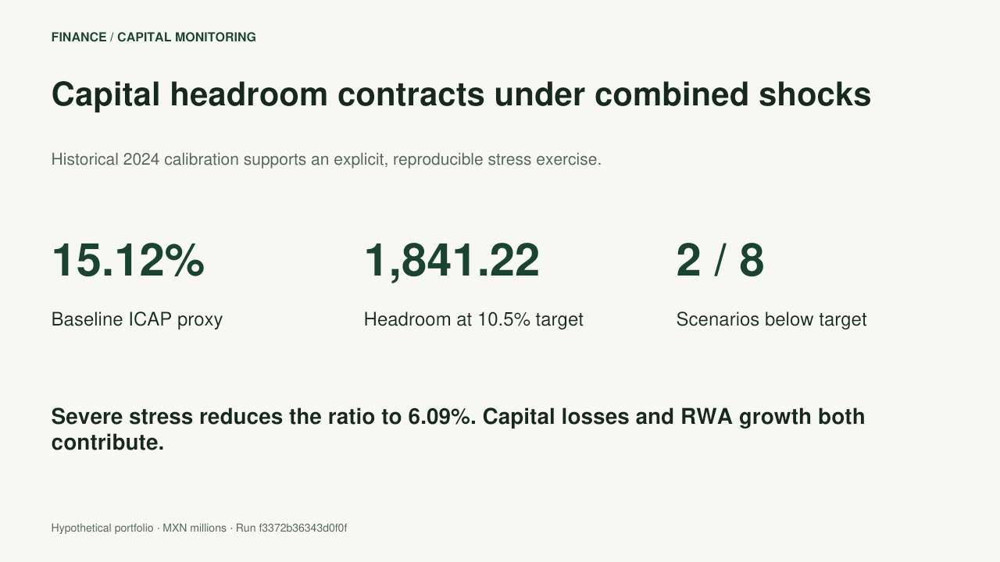

# Regulatory Capital Monitoring & Stress Testing

[](https://github.com/LeonardoSolis0303/capital-monitoring-stress/actions/workflows/ci.yml)

An independent capital analytics project for a Mexican broker-dealer context: disclosure reconciliation, ICAP monitoring, risk-weighted asset analysis, stress attribution and committee reporting.

The pipeline connects public financial disclosures to an explicitly hypothetical scenario book. Every reported outcome can be traced to versioned inputs, a documented calculation and a reproducible run. **Public financial data and assumed portfolio exposures remain distinct throughout the analysis.**



## Review the evidence

- [Committee brief](examples/base/committee_brief.md): findings and decision considerations.
- [Excel review pack](examples/office/capital_review.xlsx): scenario comparison, formula-based ratios and headroom, and disclosure controls.
- [PowerPoint committee pack](examples/office/capital_committee.pptx): executive assessment, stress outcomes, capital attribution and model governance.
- [Standalone HTML report](examples/base/report.html): consolidated review view; download and open locally.
- [Scenario results](examples/base/scenarios.csv), [sensitivity grid](examples/base/sensitivity.csv) and [reverse stress](examples/base/reverse_stress.json): machine-readable evidence.
- [Blocked update example](examples/blocked_update/committee_brief.md): an unresolved disclosure reconciliation prevents stress execution.

## Reference run

| Measure | Result |
| --- | ---: |
| Historical calibration date | 31 December 2024 |
| Modeled eligible capital | MXN 6,024 million |
| Risk-weighted assets | MXN 39,836 million |
| Baseline ICAP proxy | 15.12% |
| Headroom above the 10.5% monitoring target | MXN 1,841.22 million |
| Named scenarios | 8 |
| FX/rate sensitivity combinations | 25 |
| Scenarios below target | 2 |
| Severe-scenario ICAP | 6.09% |

These are outcomes of the hypothetical model, not stress estimates for Morgan Stanley. The historical disclosure is a calibration source; this project is unaffiliated with the issuer.

## Analytical coverage

**Capital and financial controls.** Balance-sheet reconciliation, RWA component aggregation, basic-capital/equity comparison and a ratio-proxy check precede the selected baseline's stress calculations. Regulatory deductions and Tier 2 capital are explicit modeling inputs. Negative stressed capital is retained rather than clipped.

**Stress testing.** Individual FX, rate and counterparty scenarios, combined adverse/severe conditions, business expansion and capital distribution. P&L shocks affect the numerator; credit translation/migration, market RWA and operational RWA overlays affect the denominator. Exact sequential attribution explains the change in ICAP in basis points.

**Capital monitoring.** Target headroom, capital shortfall, an alternative RWA-reduction calculation and a bracketed reverse-stress threshold. Threshold statuses are analytical monitoring labels, not supervisory classifications.

**Reporting and lineage.** CSV, HTML and a committee brief are generated deterministically. SHA-256 manifests identify input, engine and output versions. Excel and PowerPoint snapshots accompany the reference run; their builder and integrity checks are included.

## Source reconciliation

The issuer's 2025 financial statements include 2024 comparative figures and expressly identify the RWA table as unaudited. The 2024 basic-capital/RWA proxy reconciles to the disclosed ratio within the documented rounding tolerance. The corresponding 2025 proxy does not. That difference is retained as a review item: it may reflect an undisclosed capital bridge or a different reporting basis and is not treated as proof of an issuer error.

The reference scenario uses the reconciled 2024 calibration. Selecting 2025 produces a control-only report and a blocked execution status. Neither source values nor reported percentages are adjusted to force agreement.

## Reproducibility

Python 3.11+; no runtime dependencies.

```bash
python -m pip install .
python -m unittest discover -s tests -v
capital-monitor run --input data --output /tmp/capital-review
capital-monitor verify /tmp/capital-review
python scripts/verify_examples.py
python scripts/verify_office.py
```

The output directory must be new. Exit codes: `0` completed, `1` selected baseline blocked, `2` invalid inputs or integrity failure. A completed analytical run may contain scenario target breaches or review items for a different disclosure date; these are reported separately.

## Technical documentation

- [Methodology](docs/methodology.md): equations, shock conventions, attribution and reverse stress.
- [Data and sources](docs/data-and-sources.md): definitions, provenance, tolerance and calibration choice.
- [Validation](docs/validation.md): analytical benchmarks, failure cases and reproducibility.
- [Scope](docs/scope.md): regulatory mapping, assumptions and model limitations.
- [Engineering](docs/engineering.md): package structure, execution contract and Office artifacts.

**Author:** Leonardo Solís
